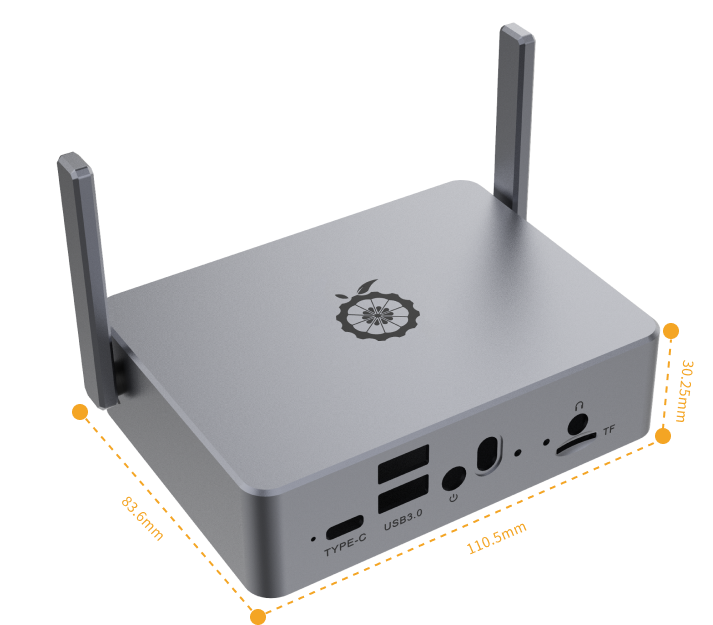
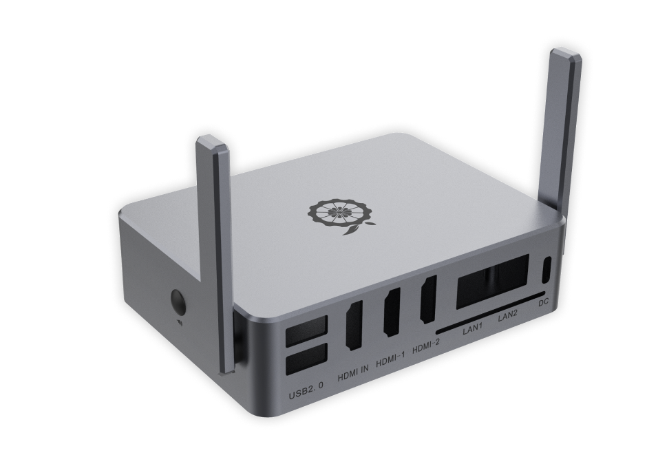

# **Devices**  

## **Orange Pi**  

An **edge device** (e.g., Orange Pi) processes data locally, reducing **latency**, enhancing **real-time decision-making**, and improving **privacy** by minimizing cloud reliance.  

### **Use Cases**  
- **Fraud detection** (banking)  
- **Voice-to-text** (customer service)  
- **Predictive maintenance** (manufacturing)  
- **Real-time monitoring** (healthcare)  

### **Benefits**  
✔ **Low power consumption**  
✔ **Reduced bandwidth usage**  
✔ **Faster response times**  
✔ **Enhanced security** 

### **Board View (Top)**  


  

### **Case View**  





🔗 [**More details here**](http://www.orangepi.org/html/hardWare/computerAndMicrocontrollers/details/Orange-Pi-5-plus.html)  

---

## **Processor**  
- **CPU**: Rockchip RK3588 (8-core, 64-bit)  
  - 4× Cortex-A76 (up to 2.4GHz)  
  - 4× Cortex-A55 (up to 1.8GHz)  

## **Memory**  
- **RAM**: 16GB (Non-upgradable, Single-channel)  

## **Graphics**  
- **GPU**: ARM Mali-G610 MP4  
  - Supports OpenGL ES 1.1/2.0/3.2, OpenCL 2.2, Vulkan 1.2  
- **NPU**:  
  - 6 TOPS (Tera Operations Per Second) for AI and machine learning  

## **Storage Options**  
- **eMMC**: Socket available (supports 32GB, 64GB, and 256GB modules)  
- **MicroSD**: Card slot for expandable storage  
- **M.2 Slot**: Supports NVMe SSDs (PCIe 3.0 x4)  

## **Display Interfaces**  
- **HDMI Outputs**:  
  - Dual HDMI 2.1 ports (up to 8K@60Hz)  
- **HDMI Input**:  
  - One HDMI input (up to 4K@60Hz)  
- **USB-C (DisplayPort 1.4)**: Supports up to 8K@30Hz  

## **Networking**  
- **Ethernet**:  
  - Dual 2.5Gbps RJ45 ports (PoE support with an optional hat)  

## **Operating System Support**  
- **Compatible OS**:  
  - Orange Pi OS  
  - Android 12  
  - Debian 11  
  - Ubuntu 24.04 *(My preferred lightweight OS)*  

---

## **Typical Use Cases for Me**  

✅ **GenAI & Machine Learning:** Running AI Rockchip toolkit for quantized Large Language Models (LLMs) & Neural Networks.  
✅ **Performance & Efficiency:** Highly capable and power-efficient system.  
✅ **Media Transcoding:** Supports Jellyfin, FFmpeg, and GStreamer.  
✅ **Daily Driver:** Always running, serving as one of my primary systems.  
✅ **Docker Management:** CasaOS for efficient containerized application management.  
✅ **Dashboards & Productivity:** Runs Dashy, Heimdall, Nextcloud, and Obsidian Notes.  
✅ **TV Streaming:** TVHeadend with advanced configurations, including custom scripts for channel switching.  
✅ **Compact & Durable:** Small form factor, metal case for durability & fanless operation.  
✅ **Hardware Capabilities:** SSD support, 16GB RAM (useful for AI/LLM loading), high-speed networking.  
✅ **File Sharing:** Samba-based file sharing across Windows, Linux PCs, Android set-top boxes, and mobile devices.  
✅ **FTP Server:** Runs a non-secure FTP version (for intranet use only) to maximize performance.  

---

## **Limitations**  

⚠️ **ARM Platform Constraints:** Limited compared to x64-based Linux systems.  
⚠️ **Vendor Support:** Minimal software support.  
⚠️ **Community Support:** Smaller community compared to mainstream x64 platforms.  
⚠️ **Hardware Constraints:** Sealed & single-channel RAM (non-upgradable), limiting speed for memory-intensive tasks.  

---

## **Extras**  

### **AI Capabilities**  
The Orange Pi features a **Rockchip RK3588 Processor** with a **3-Core NPU**, each delivering **2 TOPS**, totaling **6 TOPS** for AI inferencing.  

- **RKNN Toolkit2** – SDK for converting ONNX models to Rockchip-compatible format (conversion requires an Intel PC).  
    

  ⚠️ **Note:** Model conversion is time-consuming. I download pre-converted models from **Hugging Face repositories:**  
  - [Rockchip Models](https://huggingface.co/models?other=rk3588)  
  - [EZRKLLM Collection](https://huggingface.co/Pelochus/ezrkllm-collection)  
  - [Rockchip-Specific Models](https://huggingface.co/models?other=rockchip)  

- **RKLLM** – Used for inferencing/running LLMs on Rockchip.  (Based on C++)
    

- **RKLLM** – LLM Inference with Python & Web Interface**  
  RK3588 supports **LLM inference** using **Python** with a web-based GUI powered by **Gradio** or **Flask**. This enables easy interaction with models via a browser-friendly interface.  
  🔗 [**RKLLM Server Demo – GitHub Repository**](https://github.com/airockchip/rknn-llm/blob/main/examples/rkllm_server_demo/README.md)  

- **RKNN Model Zoo** – Deployment examples for neural network models like object detection, image classification, etc.  
  🔗 [GitHub Repository](https://github.com/airockchip/rknn_model_zoo)  

- **EZRKNPU Toolkit** – Improved version of the toolkit, though still requires manual adaptations.  
  🔗 [GitHub Repository](https://github.com/Pelochus/ezrknpu)  


### **Monitoring NPU Usage**  
To check if the NPU is active and its load per core, run:  
```sh
cat /sys/kernel/debug/rknpu/load
```


## **Demo: RK3588 Running Stable Diffusion Variant**  
A demonstration of the RK3588 running an **NPU-accelerated Stable Diffusion 1.5 LCM** on a **$130 SBC**, achieving **30 iterations per second**.  (From another user)
🔗 [View the demo on Reddit](https://www.reddit.com/r/StableDiffusion/comments/1gxbwp1/npu_accelerated_sd15_lcm_on_130_rk3588_sbc_30/?rdt=55368)  
